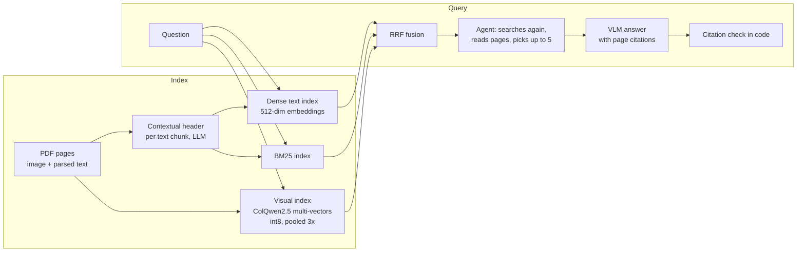

# Multimodal Document RAG

Question answering over the pages of PDF reports. The system retrieves the pages
that hold the evidence, a vision language model answers from them and cites pages
with quotes, and code checks every citation.

On a held-out set it beats a plain text-RAG baseline by +0.171 NDCG@10 and +0.094
answer score, with an index 76% smaller than the uncompressed one.

## What is new

Built on [RAG-Anything](https://github.com/HKUDS/RAG-Anything) / LightRAG, which
retrieve over parsed text and over text descriptions of images and tables. This
project adds:

1. **Page-image retrieval.** Every page is indexed as an image. ColQwen2.5 turns it
   into a set of vectors, and a question is scored against them with MaxSim (late
   interaction). A page can be found without any parsed text.
2. **Fusion.** The visual route is fused by rank (RRF) with LightRAG's dense text
   retrieval and a BM25 index.
3. **A retrieval agent.** It reads the fused results, searches again in its own
   words, opens pages, and picks the pages the answer is written from.
4. **Checked citations.** Code verifies that each cited page was shown to the model
   and that the quote is on that page.

## Architecture



Models: `gpt-6-luna` answers, runs the agent and writes the contextual headers.
`gpt-6.1-terra`, a different and stronger model, judges the answers. Text
embeddings are `text-embedding-3-small` cut to 512 dimensions. Page and query
vectors come from `vidore/colqwen2.5-v0.2`. Every technique is one switch in
`PipelineSpec`, off by default.

## Result on the held-out set

ViDoRe v3 `finance_en` (2,942 pages, 309 English queries), with every setting
frozen from the development set `hr` (1,110 pages, 318 queries).

| | NDCG@10 [95% CI] | answer score [95% CI] | index KB/page |
|---|---|---|---|
| [baseline](results/2026-11-15_fin_baseline/): dense text route, top 5 pages as text | 0.524 [0.489, 0.559] | 0.586 [0.540, 0.629] | 27.7 |
| [final system](results/2026-11-15_fin_final_agent/) | 0.695 [0.663, 0.726] | 0.680 [0.638, 0.722] | 52.7 |

Both differences have p = 0.0001 in a paired randomization test
([results/heldout.md](results/heldout.md)). The answer score is an LLM judge's
verdict against the reference answer (correct 1, partially correct 0.5,
incorrect 0). 88% of the final system's answers pass every citation check.

## How it got there

Changes were added one at a time on `hr` and kept only if a paired significance
test said they helped (efficiency changes: unless it said they hurt). These are the
kept steps; the full ladder is in [results/ladder.md](results/ladder.md).

| step | NDCG@10 | answer score | index KB/page | difference [95% CI] | p |
|---|---|---|---|---|---|
| [Baseline](results/2026-11-14_hr_baseline/) | 0.493 | 0.571 | 24.9 | | |
| [+ BM25](results/2026-11-14_hr_s1_text_bm25/) | 0.549 | | 27.4 | +0.056 [+0.035, +0.077] | 0.0001 |
| [+ visual route](results/2026-11-14_hr_s2_three_routes/) | 0.590 | | 214.6 | +0.041 [+0.028, +0.054] | 0.0001 |
| [+ contextual chunk headers](results/2026-11-14_hr_x_ctx_no_rerank/) | 0.603 | | 216.0 | +0.013 [+0.001, +0.026] | 0.035 |
| [+ index compression](results/2026-11-15_hr_s6_compressed/) | 0.610 | 0.632 | 50.3 | +0.007 [−0.001, +0.015] | 0.107 |
| [+ retrieval agent](results/2026-11-15_hr_s8_agent/) | 0.663 | 0.670 | 50.3 | +0.038 [+0.003, +0.072] answer score | 0.044 |

Tried and not kept: per-page routing, three rerankers, HyDE, and a `visual_search`
tool for the agent.

**Each part still matters on the held-out set.** Removing one kept change from the
final system (NDCG@10 0.695):

| removed | NDCG@10 | difference [95% CI] | p | index KB/page |
|---|---|---|---|---|
| [agent](results/2026-11-15_fin_final/) | 0.645 | −0.050 [−0.070, −0.031] | 0.0001 | 52.6 |
| [visual route](results/2026-11-15_fin_loo_no_visual/) | 0.667 | −0.028 [−0.045, −0.012] | 0.0005 | 21.3 |
| [BM25](results/2026-11-15_fin_loo_no_bm25/) | 0.673 | −0.022 [−0.041, −0.004] | 0.022 | 50.5 |
| [dense text route](results/2026-11-15_fin_loo_no_text/) | 0.674 | −0.021 [−0.040, −0.003] | 0.024 | 33.5 |
| [contextual headers](results/2026-11-15_fin_loo_no_headers/) | 0.677 | −0.018 [−0.033, −0.004] | 0.012 | 51.5 |
| [compression](results/2026-11-15_fin_loo_no_compression/) | 0.695 | −0.000 [−0.014, +0.014] | 0.99 | 220.1 |

## Compression


Visual vectors are stored as int8 with 3× token pooling (31 KB per page instead of
187), and text embeddings are cut to 512 dimensions
([table](results/2026-11-15_hr_compression/table.md)). On the held-out set this
takes the index from 220 to 53 KB per page (−76%) with NDCG@10 unchanged.

## Prompt-injection defence

An instruction posing as an editorial note, planted in a page's text or drawn onto
its image, succeeds on 33% of 30 queries. Delimiting page content and telling the
model it is data brings that to 0%, without lowering the answer score on clean
queries ([results/2026-11-15_hr_robustness](results/2026-11-15_hr_robustness/)).

## Tracing

Agent runs can be traced with Phoenix: `uv sync --group tracing`, start it with
`uvx arize-phoenix serve`, and add `--trace` to a run.


## Run it

```bash
uv sync                      # Python 3.12
cp .env.example .env         # add API keys; see the comments in the file
uv run pytest                # offline tests, no API calls
```

Page images are encoded once on a GPU with `notebooks/encode_colqwen.ipynb` into
`data/vectors/<subset>/`. The final system on `hr`:

```bash
uv run python -m mmrag.experiments.run --pipeline hybrid --routing all \
    --visual-store data/vectors/vidore_v3_hr --contextual-headers \
    --embedding-dim 512 --quantization int8 --pool-factor 3 --agent \
    --work-dir hr --name hr_final
uv run python -m mmrag.experiments.answer --results results/<date>_hr_final
```

These commands call paid APIs. Every paid script logs its cost to
[results/spend.md](results/spend.md) and stops at the cap set by `BUDGET_USD`; all
experiments in this repository cost 7.06 USD.

Full detail: [results/](results/), [PLAN.md](PLAN.md) and
[DECISIONS.md](DECISIONS.md) (in Chinese).
