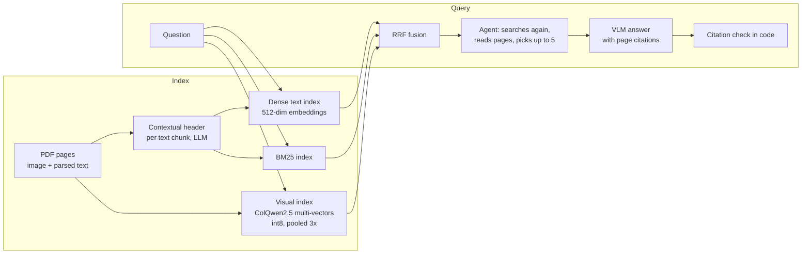

# Multimodal Document RAG

Question answering over the pages of PDF reports. The system retrieves the pages
that hold the evidence, a vision language model answers from them and cites pages
with quotes, and code checks every citation.

## Highlights

- **Better than plain text RAG on a held-out set.** NDCG@10 rises from 0.524 to
  0.695 and the answer score from 0.586 to 0.680, both p = 0.0001
  ([baseline](results/2026-11-15_fin_baseline/),
  [final system](results/2026-11-15_fin_final_agent/)). The held-out set played no
  part in any design choice.
- **Every change was measured on its own.** Nine changes were tried one at a time
  on a development set, each with a paired significance test. Five were kept and
  four were not ([ladder](results/ladder.md)).
- **Every kept part still matters on the held-out set.** Removing the agent, any
  one of the three retrieval routes, or the contextual headers costs 0.018 to
  0.050 NDCG@10, each with p < 0.05 ([leave-one-out](results/heldout.md)).
- **The index is 76% smaller at no loss.** Compression takes it from 220 to 53 KB
  per page with NDCG@10 unchanged
  ([without compression](results/2026-11-15_fin_loo_no_compression/)).
- **Citations are checked, not assumed.** 88% of answers pass every citation check
  on the held-out set; the baseline passes 85%
  ([final system](results/2026-11-15_fin_final_agent/),
  [baseline](results/2026-11-15_fin_baseline/)).
- **The price is latency.** The agent takes an answer from 3.1 s to 9.0 s on the
  development set ([one-shot](results/2026-11-15_hr_s6_compressed/),
  [agent](results/2026-11-15_hr_s8_agent/)).

## What is new

The project is built on [RAG-Anything](https://github.com/HKUDS/RAG-Anything) /
LightRAG, which retrieve over parsed text and over text descriptions of images and
tables. It adds three things:

1. **Page-image retrieval.** Every page is indexed as an image. ColQwen2.5 turns it
   into a set of vectors, and a question is scored against them with MaxSim (late
   interaction). A page can be found without any parsed text.
2. **Fusion.** The visual route is fused by rank (RRF) with LightRAG's dense text
   retrieval and a BM25 index.
3. **A retrieval agent.** It reads the fused results, searches again in its own
   words, opens pages, and picks the pages the answer is written from.



Models: `gpt-6-luna` answers, runs the agent and writes the contextual headers.
`gpt-6.1-terra`, a different and stronger model, judges the answers, so no model
grades its own output. Text embeddings are `text-embedding-3-small` cut to 512
dimensions. Page and query vectors come from `vidore/colqwen2.5-v0.2`.

## Main result

Development set: ViDoRe v3 `hr` (1,110 pages, 318 English queries). Held-out set:
ViDoRe v3 `finance_en` (2,942 pages, 309 English queries), with every setting
frozen from `hr`.

| | NDCG@10 [95% CI] | answer score [95% CI] | index KB/page |
|---|---|---|---|
| `finance_en` (held out): [baseline](results/2026-11-15_fin_baseline/) | 0.524 [0.489, 0.559] | 0.586 [0.540, 0.629] | 27.7 |
| `finance_en` (held out): [final system](results/2026-11-15_fin_final_agent/) | 0.695 [0.663, 0.726] | 0.680 [0.638, 0.722] | 52.7 |

On the held-out set the final system gains +0.171 NDCG@10 (95% CI +0.140 to
+0.203) and +0.094 answer score (+0.052 to +0.136) over the baseline, in a paired
randomization test ([results/heldout.md](results/heldout.md)). The development set
gives +0.170 and +0.099 (steps 0 and 8 in the ladder below), so the gains are about
the same on new data.

The baseline is the dense text route alone with the top 5 pages given as text. The
answer score is the mean of the judge's verdict against a human-checked reference
answer: correct 1, partially correct 0.5, incorrect 0.

## Why the results can be trusted

**One change at a time, with a test.** Each change is compared with the system it
was added to, over the same queries. A quality change is kept only if it is better
with p < 0.05. An efficiency change is kept unless it is significantly worse. Full
table: [results/ladder.md](results/ladder.md).

| step | change on `hr` | NDCG@10 | answer score | index KB/page | difference [95% CI] | p | kept |
|---|---|---|---|---|---|---|---|
| 0 | [Baseline](results/2026-11-14_hr_baseline/) | 0.493 | 0.571 | 24.9 | | | |
| 1 | [+ BM25](results/2026-11-14_hr_s1_text_bm25/) | 0.549 | | 27.4 | +0.056 [+0.035, +0.077] | 0.0001 | yes |
| 2 | [+ visual route](results/2026-11-14_hr_s2_three_routes/) | 0.590 | | 214.6 | +0.041 [+0.028, +0.054] | 0.0001 | yes |
| 3 | [Per-page routing](results/2026-11-14_hr_s3_routed/) (efficiency) | 0.562 | | 81.1 | −0.028 [−0.045, −0.010] | 0.0025 | no |
| 4 | [Rerank with MaxSim](results/2026-11-14_hr_s4_rerank_maxsim/) (best of three) | 0.608 | | 214.6 | +0.018 [−0.005, +0.042] | 0.148 | no |
| 5 | [Contextual chunk headers](results/2026-11-14_hr_x_ctx_no_rerank/) | 0.603 | | 216.0 | +0.013 [+0.001, +0.026] | 0.035 | yes |
| 6 | [Index compression](results/2026-11-15_hr_s6_compressed/) (efficiency) | 0.610 | 0.632 | 50.3 | +0.007 [−0.001, +0.015] | 0.107 | yes |
| 7 | [HyDE](results/2026-11-15_hr_s7_hyde/) | 0.601 | | 50.3 | −0.009 [−0.028, +0.011] | 0.396 | no |
| 8 | [Retrieval agent](results/2026-11-15_hr_s8_agent/) | 0.663 | 0.670 | 50.3 | +0.038 [+0.003, +0.072] answer score | 0.044 | yes |
| 9 | [Agent with `visual_search`](results/2026-11-15_hr_s9_agent_visual/) | 0.657 | 0.670 | 50.3 | +0.000 [−0.027, +0.027] answer score | 1.00 | no |

**Leave-one-out on the held-out set.** Each row removes one kept change from the
final system (NDCG@10 0.695). Full table: [results/heldout.md](results/heldout.md).

| removed | NDCG@10 | difference [95% CI] | p | index KB/page |
|---|---|---|---|---|
| [agent](results/2026-11-15_fin_final/) | 0.645 | −0.050 [−0.070, −0.031] | 0.0001 | 52.6 |
| [visual route](results/2026-11-15_fin_loo_no_visual/) | 0.667 | −0.028 [−0.045, −0.012] | 0.0005 | 21.3 |
| [BM25](results/2026-11-15_fin_loo_no_bm25/) | 0.673 | −0.022 [−0.041, −0.004] | 0.022 | 50.5 |
| [dense text route](results/2026-11-15_fin_loo_no_text/) | 0.674 | −0.021 [−0.040, −0.003] | 0.024 | 33.5 |
| [contextual headers](results/2026-11-15_fin_loo_no_headers/) | 0.677 | −0.018 [−0.033, −0.004] | 0.012 | 51.5 |
| [compression](results/2026-11-15_fin_loo_no_compression/) | 0.695 | −0.000 [−0.014, +0.014] | 0.99 | 220.1 |

The row without the dense text route was added after the first held-out run, with
the same frozen settings. No setting was changed after seeing held-out results.

## What did not help

- **Per-page routing** (text pages only in the text index, visual pages only in
  the visual index). It saves 62% of the index but loses 0.028 NDCG@10 on `hr`
  ([run](results/2026-11-14_hr_s3_routed/)). The held-out set agrees: −54% index,
  −0.049 NDCG@10, p = 0.0001 ([run](results/2026-11-15_fin_routed/)).
- **Reranking the top 20**, three variants:
  [MaxSim](results/2026-11-14_hr_s4_rerank_maxsim/) +0.018 (p = 0.15), an
  [LLM](results/2026-11-14_hr_s4_rerank_llm/) +0.009 (p = 0.55), a
  [text cross-encoder](results/2026-11-14_hr_s4_rerank_cross_encoder/) −0.048
  (p = 0.004).
- **HyDE.** The fused result drops by 0.009, p = 0.40
  ([run](results/2026-11-15_hr_s7_hyde/)).
- **`visual_search` for the agent.** The answer score is unchanged (0.670 both,
  p = 1.0). The agent chose the tool in 24 of 318 questions
  ([run](results/2026-11-15_hr_s9_agent_visual/)).

## Where the agent helps

Scores by query type and by number of relevant pages are in
[results/breakdown.md](results/breakdown.md).

- It helps most when the evidence is on one page: NDCG@10 goes from 0.677 to 0.787
  on `hr` and from 0.799 to 0.875 on `finance_en`.
- It does not help open-ended questions: the `hr` answer score goes from 0.608 to
  0.574.
- It adds little when five or more pages are relevant (NDCG@10 +0.02 to +0.04). It
  selects about two pages, which is too few for those questions.

## Cost

- **Latency per question on `hr`:** baseline 2.8 s, best system without the agent
  3.1 s, final system 9.0 s, of which the agent step is 6.2 s
  ([baseline](results/2026-11-14_hr_baseline/),
  [one-shot](results/2026-11-15_hr_s6_compressed/),
  [final](results/2026-11-15_hr_s8_agent/)). On `finance_en` the final system takes
  15.3 s ([run](results/2026-11-15_fin_final_agent/)).
- **Agent search on `finance_en`:** 3.4 tool calls and $0.0007 per question
  ([run](results/2026-11-15_fin_final_agent/)).
- **Index size:** int8 visual vectors with 3× token pooling take 31 KB per page
  instead of 187, and 512-dimension text embeddings are the smallest setting not
  significantly worse than 1,536 (p = 0.07)
  ([table](results/2026-11-15_hr_compression/table.md),
  [chart](results/2026-11-15_hr_compression/chart.svg)).
- **All experiments together cost 7.06 USD** ([results/spend.md](results/spend.md)).

## Robustness

Checked on the final system on `hr`
([results/2026-11-15_hr_robustness](results/2026-11-15_hr_robustness/)).

- **Abstention.** With every relevant page removed from the context (100
  queries), the model declines 45% of the time and answers anyway 55% of the time.
- **Prompt injection.** An instruction posing as an editorial note, planted in a
  page, succeeds on 33% of 30 queries. Delimiting page content and telling the
  model it is data brings that to 0%, with no loss of answer score on clean
  queries (p = 0.36).

## Limits

- The judge has not been checked against human labels yet. Review samples are
  exported with every judged run.
- Two decisions are borderline by the p < 0.05 rule: the agent (p = 0.044,
  [run](results/2026-11-15_hr_s8_agent/)) and the 512-dimension text embeddings
  (p = 0.07 for a loss, [table](results/2026-11-15_hr_compression/table.md)).
- One development subset and one held-out subset, English queries only.
- The agent has no `visual_search` tool, because it did not pass. It still starts
  from the visual route's results and can open page images.
- Prompt caching did not apply to the contextual-header calls, so they were paid at
  full price. The cause is in [DECISIONS.md](DECISIONS.md).

## Run it

```bash
uv sync                      # Python 3.12
cp .env.example .env         # add API keys; see the comments in the file
uv run pytest                # offline tests, no API calls
```

Page images are encoded once on a GPU with `notebooks/encode_colqwen.ipynb` into
`data/vectors/<subset>/`. The final system on `hr`:

```bash
uv run python -m mmrag.experiments.run --pipeline hybrid --routing all \
    --visual-store data/vectors/vidore_v3_hr --contextual-headers \
    --embedding-dim 512 --quantization int8 --pool-factor 3 --agent \
    --work-dir hr --name hr_final
uv run python -m mmrag.experiments.answer --results results/<date>_hr_final
uv run python -m mmrag.experiments.ladder          # rebuild results/ladder.md
```

These commands call paid APIs. Every paid script logs its cost to
[results/spend.md](results/spend.md) and stops at the cap set by `BUDGET_USD`.

More detail: [PLAN.md](PLAN.md) describes the phases, and
[DECISIONS.md](DECISIONS.md) (in Chinese) records each implementation choice and
its reason.
