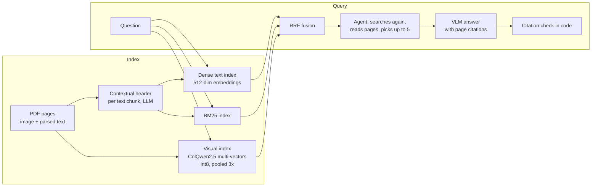
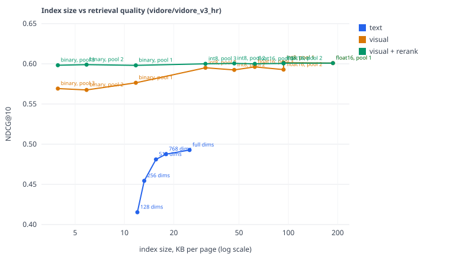
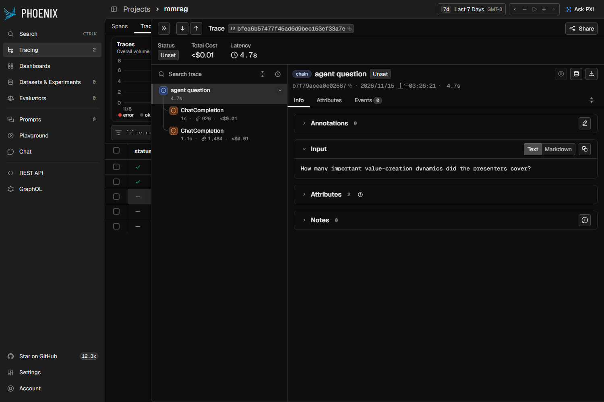

# Multimodal Document RAG

Question answering over the pages of PDF reports. The system finds the pages that
hold the evidence, a vision language model answers from them, and every answer
cites pages with quotes that are checked in code.

It is built on [RAG-Anything](https://github.com/HKUDS/RAG-Anything) / LightRAG and
adds what they lack: retrieval over whole page images (ColQwen2.5, late
interaction), fusion of that with dense text and BM25 retrieval, and an agent that
searches again and chooses the pages to answer from.

The project is organised as an **improvement ladder**: start from a plain text-RAG
baseline, add one change at a time, and keep a change only if a paired
significance test over the queries says it helps. Changes that did not help are
reported as such.

## Result in one table

Development set: ViDoRe v3 `hr` (1,110 pages, 318 English queries). Held-out test
set: ViDoRe v3 `finance_en` (2,942 pages, 309 English queries), run once with every
setting frozen from `hr`.

| | NDCG@10 [95% CI] | answer score [95% CI] | index KB/page |
|---|---|---|---|
| `hr` (dev): [baseline](results/2026-11-14_hr_baseline/) | 0.493 [0.456, 0.528] | 0.571 [0.525, 0.615] | 24.9 |
| `hr` (dev): [final system](results/2026-11-15_hr_s8_agent/) | 0.663 [0.629, 0.696] | 0.670 [0.627, 0.711] | 50.3 |
| `finance_en` (held out): [baseline](results/2026-11-15_fin_baseline/) | 0.524 [0.489, 0.559] | 0.586 [0.540, 0.629] | 27.7 |
| `finance_en` (held out): [final system](results/2026-11-15_fin_final_agent/) | 0.695 [0.663, 0.726] | 0.680 [0.638, 0.722] | 52.7 |

On the held-out set the final system is better than the baseline by +0.171 NDCG@10
(95% CI +0.140 to +0.203) and +0.094 answer score (+0.052 to +0.136), both
p = 0.0001 in a paired randomization test. On the development set the differences
are +0.170 and +0.099.

The final system: dense text, BM25 and visual retrieval over every page, fused
with RRF; contextual chunk headers; a compressed index; and a retrieval agent.

## Architecture



- A page is shown to the answering model as text or as an image, decided per page
  by a rule-based page analyzer (tables, charts and scans go in as images).
- Every piece is a switch in `PipelineSpec` (`src/mmrag/pipelines/factory.py`), off
  by default, so each can be measured against the run without it.

## The ladder on the development set

Full table with links to every run: [results/ladder.md](results/ladder.md),
generated by `python -m mmrag.experiments.ladder` from the stored results.
"Difference" is against the system the change was added to; quality changes need
p < 0.05 to be kept, efficiency changes are kept unless they are significantly worse.

| step | change | NDCG@10 | answer score | index KB/page | difference [95% CI] | p | kept |
|---|---|---|---|---|---|---|---|
| 0 | [Baseline](results/2026-11-14_hr_baseline/): text route alone, top 5 pages as text | 0.493 | 0.571 | 24.9 | | | |
| 1 | [+ BM25](results/2026-11-14_hr_s1_text_bm25/), fused with RRF | 0.549 | | 27.4 | +0.056 [+0.035, +0.077] | 0.0001 | yes |
| 2 | [+ visual route](results/2026-11-14_hr_s2_three_routes/) over every page | 0.590 | | 214.6 | +0.041 [+0.028, +0.054] | 0.0001 | yes |
| 3 | [Per-page routing](results/2026-11-14_hr_s3_routed/) (efficiency) | 0.562 | | 81.1 | −0.028 [−0.045, −0.010] | 0.0025 | no |
| 4 | Rerank top 20: [MaxSim](results/2026-11-14_hr_s4_rerank_maxsim/) (best of three) | 0.608 | | 214.6 | +0.018 [−0.005, +0.042] | 0.148 | no |
| 5 | [Contextual chunk headers](results/2026-11-14_hr_x_ctx_no_rerank/) | 0.603 | | 216.0 | +0.013 [+0.001, +0.026] | 0.035 | yes |
| 6 | [Index compression](results/2026-11-15_hr_s6_compressed/) (efficiency) | 0.610 | 0.632 | 50.3 | +0.007 [−0.001, +0.015] | 0.107 | yes |
| 7 | [HyDE](results/2026-11-15_hr_s7_hyde/) | 0.601 | | 50.3 | −0.009 [−0.028, +0.011] | 0.396 | no |
| 8 | [Retrieval agent](results/2026-11-15_hr_s8_agent/) | 0.663 | 0.670 | 50.3 | +0.038 [+0.003, +0.072] answer score | 0.044 | yes |

Reference runs: [BM25 alone](results/2026-11-14_hr_ref_bm25/) 0.497,
[visual alone](results/2026-11-14_hr_ref_visual/) 0.601. Equal-weight fusion of the
three routes (0.590) is below the visual route alone; the fused system only passes
it after the later steps.

Answer score is the mean of an LLM judge's verdict against the reference answer
(correct 1, partially correct 0.5, incorrect 0). Answers were judged only where
they decide something: the baseline, the best system without the agent, and the
final system.

## Held-out test

`finance_en` was used once, with every setting frozen from `hr`. Full table:
[results/heldout.md](results/heldout.md).

**Leave-one-out.** Each row removes one kept change from the final system and
compares retrieval with the final system (NDCG@10 0.695).

| removed | NDCG@10 | difference [95% CI] | p | index KB/page |
|---|---|---|---|---|
| [agent](results/2026-11-15_fin_final/) | 0.645 | −0.050 [−0.070, −0.031] | 0.0001 | 52.6 |
| [visual route](results/2026-11-15_fin_loo_no_visual/) | 0.667 | −0.028 [−0.045, −0.012] | 0.0005 | 21.3 |
| [BM25](results/2026-11-15_fin_loo_no_bm25/) | 0.673 | −0.022 [−0.041, −0.004] | 0.022 | 50.5 |
| [contextual headers](results/2026-11-15_fin_loo_no_headers/) | 0.677 | −0.018 [−0.033, −0.004] | 0.012 | 51.5 |
| [compression](results/2026-11-15_fin_loo_no_compression/) | 0.695 | −0.000 [−0.014, +0.014] | 0.99 | 220.1 |

Every kept quality change also matters on the held-out set, and compression again
costs nothing: 220 → 53 KB per page (−76%).

**Per-page routing** was not kept on `hr`, and the held-out set agrees.
[Routed](results/2026-11-15_fin_routed/) against the same system without routing
(and without the agent): the index shrinks from 52.6 to 24.1 KB per page (−54%; the
analyzer sends 668 of 2,942 pages to the visual index), and NDCG@10 falls from
0.645 to 0.596 (−0.049, p = 0.0001).

Other numbers for the final system on `finance_en`: 3.4 tool calls and $0.0007 per
question for search; 2.0 pages read per answer; 88% of answers pass every citation
check (baseline 85%); the model declines to answer 6.8% of questions (baseline
18.8%).

## Index size against quality



Each point is one retrieval run of that route alone on `hr`
([table](results/2026-11-15_hr_compression/table.md)).

- Text embeddings (`text-embedding-3-small`, Matryoshka truncation): 512 dimensions
  is the smallest setting not significantly worse than the full 1,536 (−0.012,
  p = 0.07); 256 and 128 are clearly worse.
- Visual vectors: int8 costs nothing; 3× token pooling costs 0.005 (not
  significant); binary is significantly worse. int8 with 3× pooling takes 31 KB per
  page instead of 187.
- With a full-precision MaxSim rerank of the top 20, even binary vectors pooled 3×
  (3.9 KB per page) score 0.598. That needs the full vectors kept on disk, so it is
  shown but not used.
- In the full system the chosen settings cut the index from 216 to 50 KB per page
  (−77%) with no loss.

## Robustness

Side evaluations on the final system
([results/2026-11-15_hr_robustness](results/2026-11-15_hr_robustness/)).

- **Abstention.** With every relevant page removed from the context (100 queries)
  the model says the pages do not contain the answer 45% of the time and answers
  anyway 55% of the time. On normal queries with a relevant page in the context it
  wrongly declines 8.2% of the time.
- **Prompt injection.** An instruction is planted in one relevant page, in its text
  or drawn onto its image (30 queries). A blunt "ignore the question" instruction
  never succeeds. A quieter one that poses as an editorial note and asks for a
  sentence to be appended succeeds on 33% of queries. Delimiting page content and
  telling the model it is data brings that to 0%, and does not lower the answer
  score on clean queries (0.670 → 0.682, p = 0.36).

## What did not help

- **Per-page routing** (send text pages to the text index and visual pages to the
  visual index): saves 62% of the index but loses 0.028 NDCG@10 (p = 0.0025).
- **Reranking**, all three variants: MaxSim +0.018 (p = 0.15), an LLM listwise
  rerank +0.009 (p = 0.55, $0.0007 and 3.8 s per query), a text cross-encoder
  −0.048 (p = 0.004, 12 s per query on CPU).
- **HyDE**: it improves the text route and BM25 individually (0.509 → 0.518 and
  0.507 → 0.529) but the fused result drops by 0.009 (p = 0.40).
- **Prompt caching** for the contextual headers: the prompt is ordered so that the
  shared pages come first, but the API reported no cached tokens for it.

## How to run

```bash
uv sync                      # Python 3.12
cp .env.example .env         # add API keys; see the comments in the file
uv run pytest                # offline tests, no API calls
```

Page images are encoded once on a GPU (`notebooks/encode_colqwen.ipynb` on Kaggle)
into `data/vectors/<subset>/`. Then, for the final system on `hr`:

```bash
uv run python -m mmrag.experiments.run --pipeline hybrid --routing all \
    --visual-store data/vectors/vidore_v3_hr --contextual-headers \
    --embedding-dim 512 --quantization int8 --pool-factor 3 --agent \
    --work-dir hr --name hr_final
uv run python -m mmrag.experiments.answer --results results/<date>_hr_final
uv run python -m mmrag.experiments.ladder          # rebuild results/ladder.md
```

These call paid APIs. Every paid script logs its cost to
[results/spend.md](results/spend.md) and stops at the cap set by `BUDGET_USD`.
All experiments in this repository cost 6.24 USD in total.

To check the LLM judge against your own labels, fill the `human_verdict` column of
a run's `review_sample.csv` and run
`uv run python -m mmrag.eval.answers results/<run>/review_sample.csv`.

Tracing of agent runs (optional): `uv sync --group tracing`, start Phoenix
(`uvx arize-phoenix serve`) and add `--trace`.



## Limits of these results

- The agent ran without `visual_search`: encoding new queries with ColQwen2.5 needs
  about 8 GB of free memory, which the development machine did not have. It still
  starts from the visual route's results for the original question.
- The judge has not yet been checked against human labels; review samples are
  exported with every judged run.
- Two decisions are borderline by the p < 0.05 rule: the agent (p = 0.044) and the
  512-dimension text embeddings (p = 0.07 for a loss).
- `DECISIONS.md` (in Chinese) records every implementation choice and its reason;
  `PLAN.md` describes the phases.
